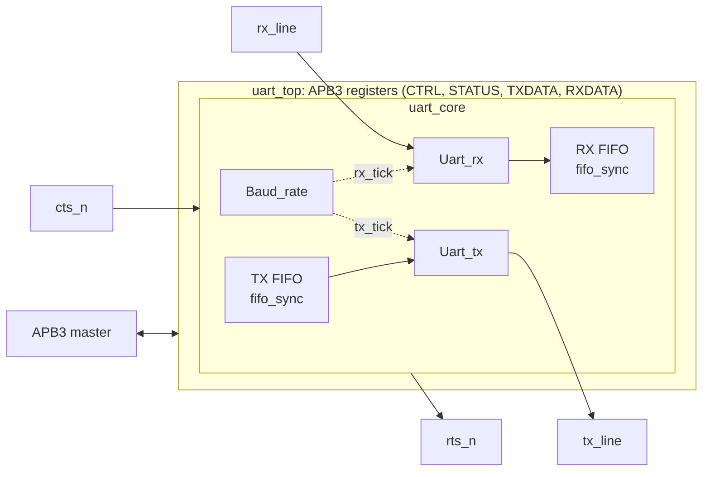

# UART Transceiver — Parameterized RTL (Verilog)

> **Part of [`vlsi-rtl-projects`](https://github.com/debjitdas-ece/vlsi-rtl-projects) — Project #2 of 6**

A fully parameterized, industrial-style UART transmitter/receiver pair designed and
verified with Icarus Verilog + GTKWave (no physical FPGA target required).

---

## Table of Contents

- [Overview](#overview)
- [Block Diagram](#block-diagram)
- [File Structure](#file-structure)
- [Module Descriptions](#module-descriptions)
- [Configurability](#configurability)
- [Architecture & Key Design Decisions](#architecture--key-design-decisions)
- [Verification — 286 / 286 Passing](#verification--286--286-passing)
- [Results — All Testbenches](#results--all-testbenches)
- [Bug Log — Simulation-Driven Debugging](#bug-log--simulation-driven-debugging)
- [How to Run](#how-to-run)
- [Waveform Guide](#waveform-guide)
- [Known Scope / Deliberately Deferred](#known-scope--deliberately-deferred)
- [What's Next](#whats-next)

---

## Overview

This project implements a complete UART transceiver capable of runtime reconfiguration —
data width, parity mode, and stop-bit count are all selectable via input ports, not
compile-time parameters. This mirrors how real 16550-style UART peripherals allow
software to reconfigure the same hardware on the fly.

The receiver uses **16× oversampling with a 3-tap majority-vote** instead of single-point
center sampling, making it resilient to single-sample noise glitches.

---

## Block Diagram



`Uart_tx` / `Uart_rx` / `Baud_rate` are the original Tx/Rx layer (286-check testbench); `uart_core` adds the FIFOs and flow-control pins; `uart_top` adds the APB3 register interface.

---

## File Structure

```
03_UART/
├── Baud_rate.v       — Baud generator (rx_tick: 16× oversample, tx_tick: 1× baud)
├── Uart_tx.v         — Transmitter FSM: IDLE → START → DATA → PARITY → STOP
├── Uart_rx.v         — Receiver FSM: IDLE → START → DATA → PARITY → STOP/STOP2
├── Uart_tb.v         — Self-checking Tx/Rx testbench, 286 directed + swept test cases
├── fifo_sync.v       — Synchronous FIFO
├── uart_core.v       — Tx/Rx + FIFOs + flow control (`rts_n`) + overrun flag
├── uart_top.v        — Register-mapped wrapper (CTRL / STATUS / data)
├── tb_uart_core.v    — Core testbench: FIFO order, full/overflow, RTS, overrun, parity (44 checks)
├── tb_uart_top.v     — Register-interface testbench (11 checks)
└── Makefile          — `make test` runs all three testbenches (this is what CI runs)
```

---

## Module Descriptions

### `baud_gen` — Baud Generator

```
Inputs  : clk, rst
Outputs : rx_tick (16× baud rate pulse), tx_tick (1× baud rate pulse)
Params  : CLK_F (default 50 MHz), BAUD_R (default 115200), O=16 (oversample ratio)
```

A two-counter chain: the first counter (`c`) divides the system clock to generate
`rx_tick` at 16× the baud rate. A second counter (`t`) counts 16 rx_ticks and
generates `tx_tick` on every 16th one — exactly one pulse per baud period. Both
counters use `$clog2`-computed widths so they automatically size to the parameters.

---

### `uart_tx` — Transmitter FSM

```
Inputs  : clk, rst, tx_tick, sr (send request), d[7:0] (data byte)
          dbit[3:0] (data width 5–8), sp_t (2-stop-bit), p_en (parity enable), psel (0=even, 1=odd)
Outputs : tx_line (serial out), idle
```

**State machine: IDLE → START → DATA → PARITY → STOP**

| State | Action |
|-------|--------|
| IDLE  | Holds `tx_line` high; captures input byte into `data` register on `sr` pulse |
| START | Drives `tx_line` low for 1 baud period (start bit) |
| DATA  | Shifts out bits LSB-first, advances on each `tx_tick`, for `dbit` bits |
| PARITY| Transmits computed even/odd parity bit (skipped if `p_en=0`) |
| STOP  | Drives `tx_line` high; stays for 2 baud periods if `sp_t=1` |

Key detail: the input byte `d` is **latched into `data` the moment `sr` fires in IDLE**,
so changing the `d` bus mid-frame cannot corrupt the in-flight frame.

---

### `uart_rx` — Receiver FSM

```
Inputs  : clk, rst, rx_tick, rx_line (serial in)
          dbit[3:0], sp_t, p_en, psel
Outputs : q[7:0] (received byte), rx_done, frame_err, parity_err
```

**State machine: IDLE → START → DATA → PARITY → STOP → STOP2**

| State  | Action |
|--------|--------|
| IDLE   | Watches `rx_line`; falling edge triggers START |
| START  | Waits 16 rx_ticks; samples at tick 7 to validate the start bit |
| DATA   | For each bit, collects majority votes at ticks 6, 7, 8 of the 16-tick window; latches bit at tick 15 |
| PARITY | Same majority-vote sampling; compares against expected parity; sets `parity_err` if mismatch |
| STOP   | Validates stop bit; sets `frame_err` if line is low; asserts `rx_done` (if 1-stop mode) |
| STOP2  | Second stop-bit check; asserts `rx_done` and ORs `frame_err` |

**Majority vote logic:**

```
At rx_tick AND (t_counter == 6 or 7 or 8):
    mv_cnt accumulates the number of '1' samples seen
At tick 15:
    sampled bit = (mv_cnt >= 2)   ← 2-of-3 majority
```

This rejects any single-sample glitch in the oversampled window without adding latency.

---

### `fifo_sync` — Synchronous FIFO

```
Params  : WIDTH (8), DEPTH (16), ALMOST_FULL_THRESH (2), ALMOST_EMPTY_THRESH (2)
Inputs  : clk, rst, wr_en, rd_en, wr_data[WIDTH-1:0]
Outputs : rd_data[WIDTH-1:0], full, empty, almost_full, almost_empty, count
```

Single-clock FIFO used on both the TX and RX paths. `count` reports occupancy.

---

### `uart_core` — Tx/Rx + FIFOs + Flow Control

```
Params  : FIFO_DEPTH (16)
Inputs  : clk, rst, dbit[3:0], sp_t, p_en, psel      (same runtime configuration as the bare Tx/Rx)
          tx_wr_en, tx_wr_data[7:0]                  (push a byte into the TX FIFO)
          rx_rd_en                                   (pop a byte from the RX FIFO)
          rx_line, cts_n
Outputs : tx_line, rts_n, rx_rd_data[7:0]
          tx_full, tx_empty, rx_empty, rx_full
          rx_overrun_err, frame_err, parity_err
```

Wraps the baud generator, `Uart_tx` and `Uart_rx` with a TX FIFO and an RX FIFO, which removes
the polling requirement of the bare pair: software pushes bytes with `tx_wr_en` and pops
received bytes with `rx_rd_en`. `tb_uart_core` (44 checks) covers:

- byte order through the FIFOs (a single byte, a 5-byte sequence and a full 16-byte drain)
- `tx_full` at 16 entries, and a push into a full FIFO being dropped without corrupting the stream
- `rx_full`, and `rts_n` asserting at 14 of 16 entries
- `rx_overrun_err` when the RX FIFO overflows, with the 16 buffered bytes still read out in order
- no parity error on a clean frame

---

### `uart_top` — APB3 Register Wrapper

```
Params  : FIFO_DEPTH (16)
Inputs  : PCLK, PRESETn, PSEL, PENABLE, PWRITE, PADDR[7:0], PWDATA[31:0], rx_line, cts_n
Outputs : PRDATA[31:0], PREADY, tx_line, rts_n
```

Zero-wait-state APB3 slave (`PREADY` tied high) around `uart_core`.

| Offset | Register | Access | Fields |
|--------|----------|--------|--------|
| 0x00 | CTRL | R/W | [0] EN, [1] PARITY_EN, [2] PARITY_ODD, [3] TWO_STOP_BITS, [7:4] DBIT |
| 0x04 | STATUS | RO | [0] TX_EMPTY, [1] TX_FULL, [2] RX_EMPTY, [3] RX_FULL, [4] FRAME_ERR, [5] PARITY_ERR, [6] OVERRUN_ERR |
| 0x0C | TXDATA | WO | [7:0]: a write pushes a byte into the TX FIFO |
| 0x10 | RXDATA | RO | [7:0]: a read pops a byte from the RX FIFO |

Design decision: `CTRL.EN` gates `uart_core` through its reset input. While EN=0 the FIFOs stay
empty and both FSMs sit in IDLE, matching how a real peripheral's enable bit behaves; software must
set EN before `TXDATA` / `RXDATA` do anything. The baud rate is still compile-time only, so there
is no `BAUD_DIV` register. `tb_uart_top` (11 checks) covers CTRL readback, STATUS flags, received-byte
arrival, a 5-byte burst and `TX_FULL` / `RX_EMPTY` via the STATUS register.

---

### `tb_uart` — Self-Checking Testbench

The testbench loopbacks `tx_line → rx_line` (with optional injection mux), runs 8 test
groups, and prints `PASS`/`FAIL` with signal values for each case. Final summary line
shows total pass/fail count.

Three internal tasks handle all test patterns:

- `send_and_check` — Sends a byte, waits for `rx_done`, checks `q`, `frame_err`, `parity_err`
- `inject_test` — Forces a bad parity or bad stop bit by flipping the line at the right state
- `noise_glitch_test` — Injects a single-tap glitch into a specific bit/tap and confirms majority vote corrects it

---

## Configurability

All of the following are **runtime inputs**, not compile-time parameters. The same
synthesized hardware can be reconfigured each transfer:

| Port   | Width | Function |
|--------|-------|----------|
| `dbit` | 4-bit | Data width: 5, 6, 7, or 8 bits |
| `p_en` | 1-bit | Parity enable (0 = no parity) |
| `psel` | 1-bit | Parity select: 0 = even, 1 = odd |
| `sp_t` | 1-bit | Stop bits: 0 = 1 stop bit, 1 = 2 stop bits |

Clock/baud defaults (compile-time parameters in `baud_gen`):

| Parameter | Default | Notes |
|-----------|---------|-------|
| `CLK_F`   | 50 MHz  | System clock frequency |
| `BAUD_R`  | 115200  | Baud rate |
| `O`       | 16      | Oversample ratio |

---

## Architecture & Key Design Decisions

### 1. 16× Oversampling with 3-Tap Majority Vote

Instead of sampling at the center of each bit period once, the RX samples at ticks
6, 7, and 8 (of 16), and takes a majority decision. A single glitch on any one of the
three taps is corrected without any additional latency. This is the same technique used
in industrial UART controllers like the 16550A.

### 2. Start-Bit Re-synchronization

When the RX detects a falling edge in IDLE, it immediately resets its tick counter to 0
and re-references all subsequent timing to that edge. This eliminates clock drift
accumulation across long frames.

### 3. Latched TX Data Register

The transmitter captures `d[7:0]` into an internal register `data` the moment `sr` fires.
This means the caller is free to change the `d` bus immediately after pulsing `sr` —
there is no hold-time requirement beyond the single-cycle capture.

### 4. Runtime Register-Style Configuration

`dbit`, `p_en`, `psel`, and `sp_t` behave like control registers in a real peripheral.
This is a deliberate architectural choice: it matches 16550-style UART behavior and is
more interesting as a portfolio item than a static-parameter design.

### 5. Compact RTL Density

The entire design (excluding testbench) is 99 lines of Verilog across 3 modules. The
area footprint is dominated by the data register and state flip-flops. No vendor IPs
or macros are used.

---

## Verification — 286 / 286 Passing

All 286 test cases pass with zero failures on Icarus Verilog v12.

| Group | Cases | Coverage |
|-------|-------|----------|
| G1 | 6  | Basic 8N1: 0x00, 0xFF, 0xA5, 0x5A, 0x01, 0x80 |
| G2 | 256| Full byte sweep 0x00–0xFF with 8E1 (even parity) |
| G3 | 6  | 8O1 (odd parity): same 6 corner-case bytes |
| G4 | 4  | 7E1 (7-bit data width): 0x7F, 0x55, 0x00, 0x41 |
| G5 | 3  | Fault injection: clean, forced parity error, forced frame error |
| G6 | 1  | Spurious `sr` while TX busy — confirms no mid-frame corruption |
| G7 | 5  | Single-tap glitch injection at various bits and taps — majority vote correction confirmed |
| G8 | 5  | 2-stop-bit mode (8N2) and combined 8E2 |

**Test infrastructure highlights:**

The testbench includes a hardware injection mux (`inject_en` / `inject_val`) that
overrides the loopback line at the RX input. This lets the testbench precisely corrupt
specific bits during specific receiver states — no software trickery, pure RTL signal
manipulation — making the error-injection tests as realistic as possible.

---

## Results — All Testbenches

| Testbench | Checks | Result |
|---|---|---|
| `Uart_tb` (Tx/Rx, 16× oversample) | 286 | 286 pass, 0 fail |
| `tb_uart_core` | 44 | 44 pass, 0 fail |
| `tb_uart_top` | 11 | 11 pass, 0 fail |

Reproduce: `make -C 03_UART test`

---

## Bug Log — Simulation-Driven Debugging

All bugs were found by running the simulator, observing actual waveform values, and
tracing causality — not by inspection.

| # | Symptom | Root Cause | Fix |
|---|---------|------------|-----|
| 1 | RX stuck in START state | `start_ok` sampled on tick 15 but `ns` already evaluated one tick earlier | Moved `start_ok` sampling to tick 7, matching FSM transition timing |
| 2 | Majority vote always 0 | `mv_cnt` reset every rx_tick instead of only at start of bit window | Changed reset condition to reset only when entering DATA/PARITY state |
| 3 | `rx_done` asserted for 2 cycles in 2-stop mode | STOP2 transition to IDLE left `rx_done` high one extra cycle | Added explicit `rx_done <= 0` in the `else` branch of the stop-state block |
| 4 | `parity_err` persisted into next frame | Flag was latched but never cleared before a new frame started | Added `parity_err <= 0` in the IDLE→START transition |

---

## How to Run

Requires: [Icarus Verilog](https://bleyer.org/icarus/) (`iverilog` / `vvp`) and optionally [GTKWave](https://gtkwave.sourceforge.net/).

```bash
# All three testbenches (what CI runs)
make test

# Tx/Rx testbench only
# Compile
iverilog -o sim_uart Baud_rate.v Uart_tx.v Uart_rx.v Uart_tb.v

# Simulate (prints PASS/FAIL log to stdout)
vvp sim_uart

# View waveforms
gtkwave wave.vcd
```

Expected final line from the simulator:

```
=== TOTAL: 286 PASS  0 FAIL — CLEAN ===
```

---

## Waveform Guide

Run the simulation to generate `wave.vcd` (git-ignored, not stored in the repo), then load it in GTKWave. Suggested signal groups:

**Clocks & Ticks**
```
clk  rx_tick  tx_tick
```

**TX Path**
```
sr  d[7:0]  tx_line  idle
uart_tx.s[2:0]  uart_tx.data[7:0]  uart_tx.bit_idx[3:0]
```

**RX Path**
```
rx_in  rx_done  q[7:0]  frame_err  parity_err
uart_rx.s[2:0]  uart_rx.t_counter[3:0]  uart_rx.mv_cnt[1:0]
```

Zoom into a single frame to see the 16-tick bit windows and majority vote accumulation.
A full 8N1 frame at 115200 baud takes ~8.68 µs; at 50 MHz simulation time each baud
period is 434 clock cycles (27.1 µs simulation time at 1 ns/clock).

---

## Known Scope / Deliberately Deferred

These are architectural omissions, not bugs. They are listed here because a real
production UART controller would require them.

| Feature | Status | Notes |
|---------|--------|-------|
| TX/RX FIFO | Done (`uart_core`, `fifo_sync`) | 16-deep with full/empty/almost flags; the bare `Uart_tx` / `Uart_rx` pair still needs polling |
| Flow control | Done (`uart_core`) | `rts_n` output and `cts_n` input |
| APB3 register wrapper | Done (`uart_top`) | Zero-wait-state APB3 slave; an AXI4-Lite wrapper is not built |
| Runtime baud-rate divider | Deferred | Baud rate is compile-time only; no `BAUD_DIV` register |
| UVM environment, coverage and SVA | Planned | The current testbenches are directed |

---

## What's Next

- **UVM environment:** interface, driver, monitor, scoreboard and reference model, with functional coverage (baud, data width, parity, error injection)
- **SVA bind modules:** FIFO full/empty invariants and the APB3 handshake
- **Runtime baud divider:** a `BAUD_DIV` register driving a runtime divider in `Baud_rate.v`
