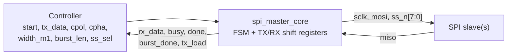
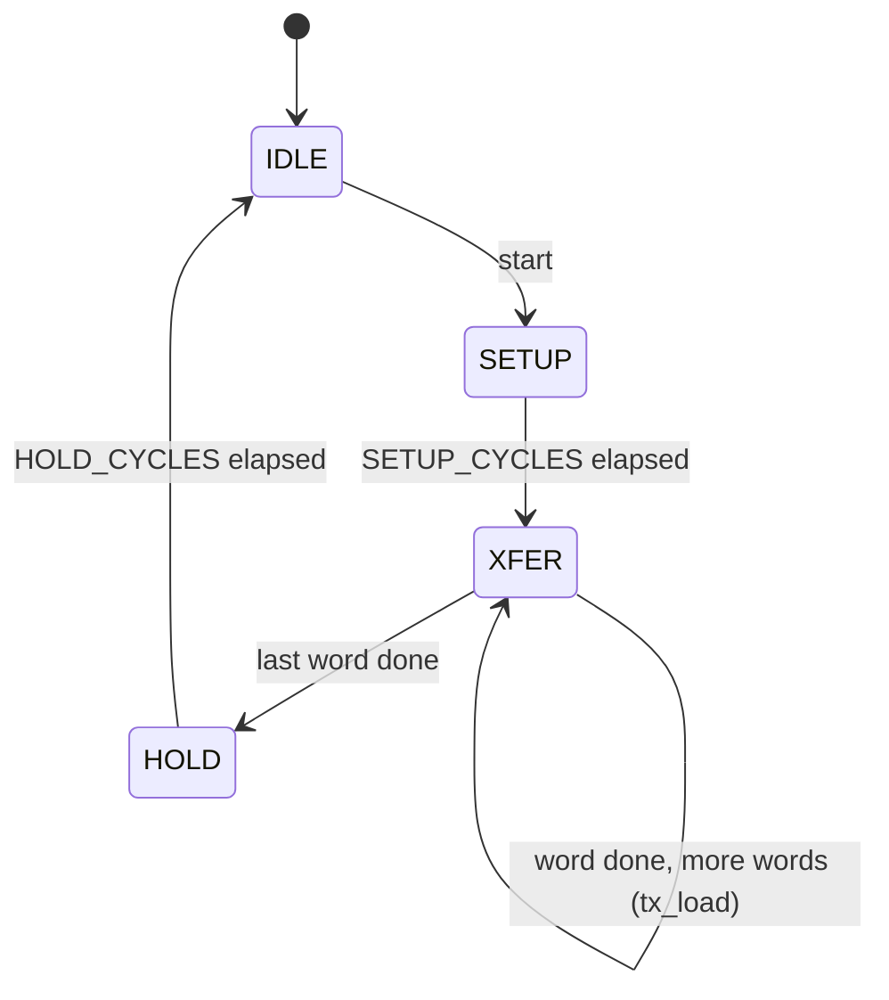

# SPI Master — Parameterized RTL (Verilog)

> **Part of [`vlsi-rtl-projects`](https://github.com/debjitdas-ece/vlsi-rtl-projects) — Project #3 of 6**

A fully parameterized SPI Master controller supporting all 4 SPI modes (CPOL/CPHA),
verified with a self-checking testbench and a behavioral slave BFM.
Designed and simulated with Icarus Verilog + GTKWave.

---

## Table of Contents

- [Overview](#overview)
- [Block Diagram](#block-diagram)
- [File Structure](#file-structure)
- [Module Descriptions](#module-descriptions)
- [Configurability](#configurability)
- [Architecture & Key Design Decisions](#architecture--key-design-decisions)
- [Verification — All Checks Passing](#verification--all-checks-passing)
- [Results — All Testbenches](#results--all-testbenches)
- [How to Run](#how-to-run)
- [Waveform Guide](#waveform-guide)
- [Known Scope / Deliberately Deferred](#known-scope--deliberately-deferred)
- [What's Next](#whats-next)

---

## Overview

This project implements a full-duplex SPI Master capable of operating in any of the
four standard SPI modes. The clock polarity (CPOL) and clock phase (CPHA) are
runtime-selectable inputs, not compile-time parameters, so the same hardware
can talk to different SPI peripherals without re-synthesis.

The design includes parametric setup and hold timing around SS, ensuring
clean chip-select assertion before the first SCLK edge and deassertion
only after the last edge — matching real peripheral timing requirements.

---

## Block Diagram





`spi_master` has the same FSM without the `XFER → XFER` loop (one word per SS assertion).

---

## File Structure

```
04_SPI/
├── spi_master.v      — SPI master RTL: IDLE → SETUP → XFER → HOLD FSM
├── spi_slave.v       — Behavioral slave BFM (Bus Functional Model) for verification
├── spi_tb.v          — Self-checking testbench: all 4 modes × 6 patterns + edge cases
├── spi_master_core.v     — Burst / multi-SS / variable-width evolution of spi_master
├── spi_slave_bfm_burst.v — Slave BFM that reloads its TX register at word boundaries
├── tb_spi_master_core.v  — Testbench for spi_master_core (39 checks)
├── Makefile              — `make test` runs both testbenches (this is what CI runs)
└── README.md             — This file
```

---

## Module Descriptions

### `spi_master` — SPI Master Controller

```
Parameters : CLK_F (50 MHz), SPI_F (1 MHz), SETUP_CYCLES (8), HOLD_CYCLES (8)
Inputs     : clk, rst, start, tx_data[7:0], cpol, cpha, miso
Outputs    : mosi, sclk, ss, rx_data[7:0], busy, done
```

**State machine: IDLE → SETUP → XFER → HOLD**

| State | Action |
|-------|--------|
| IDLE  | Waits for `start` pulse; captures `tx_data` into shift register |
| SETUP | Asserts SS (`ss=0`), holds for `SETUP_CYCLES` before first SCLK edge |
| XFER  | Generates exactly 16 SCLK edges (8 bits × 2 edges); samples MISO and shifts MOSI on correct edges per mode |
| HOLD  | Keeps SS low for `HOLD_CYCLES` after last SCLK edge, then releases |

Key signals:

| Signal | Description |
|--------|-------------|
| `busy` | High during SETUP, XFER, HOLD — caller must wait before issuing next `start` |
| `done` | Single-cycle pulse when the last MISO bit is captured (asserted inside XFER, one cycle before SS releases) |
| `ss`   | Active-low chip select, derived from `~busy` |
| `sclk` | Idles at `cpol` level; toggles every `N` system clocks during XFER |

---

### `spi_slave` — Behavioral Slave (Verification Only)

```
Parameters : DW = 8 (data width)
Inputs     : sclk, ss, cpol, cpha, mosi, tx_data[DW-1:0]
Outputs    : miso, rx_data[DW-1:0], rx_valid
```

This is a Bus Functional Model — not synthesizable RTL. It models a real SPI slave
device for testbench purposes only. It handles all 4 SPI modes correctly using the
same `cpol ^ cpha` (mode_xor) trick as the master, and drives `rx_valid` for one
cycle when a full byte has been received.

The BFM resets its shift register and bit counter on every `negedge ss`, which is
how real SPI peripherals behave.

---

### `spi_master_core` — Burst / Multi-SS / Variable-Width Master

```
Parameters : CLK_F, SPI_F, SETUP_CYCLES, HOLD_CYCLES, MAX_WIDTH (16), MAX_SS (8)
Inputs     : clk, rst, start, tx_data[15:0], cpol, cpha,
             width_m1[3:0]  (word width minus 1; 7 = legacy 8-bit),
             burst_len[7:0] (words per transfer; 1 = legacy single word),
             ss_sel[2:0], miso
Outputs    : mosi, sclk, ss_n[7:0] (one-hot, active low), rx_data[15:0],
             busy, done (once per word), burst_done (once per burst), tx_load
```

This is a new module rather than a wrapper, because continuous-SS burst mode changes the
XFER → HOLD transition and the SS timing inside the FSM itself. `spi_master.v` is left untouched,
so its 531-check regression stays a valid frozen reference. With `burst_len = 1` and
`width_m1 = 7` the core is meant to be cycle-identical to `spi_master`, and the first test group
checks exactly that.

- **Burst:** SS stays asserted across all words; `tx_load` pulses when the next word's `tx_data` must be valid.
- **Multi-SS:** `ss_sel` selects one of 8 one-hot active-low `ss_n` lines.
- **Variable width:** `width_m1` sets the word length from 1 to 16 bits; `rx_data` is right-justified.
- **CPHA = 1 corner case:** the final sample of a word and the next-word reload land on the same cycle, so RX capture and bit-counter reset must be able to fire together.

`spi_slave_bfm_burst.v` is a copy of `spi_slave.v` that also reloads its TX register at the last edge of each word. The original BFM only reloads when SS falls, so it would send zeros after the first word of a burst. `spi_slave.v` itself is unchanged because `spi_tb.v` depends on it.

| Group | Checks | Coverage |
|-------|--------|----------|
| G1 | 1 | Cycle-by-cycle diff against the frozen `spi_master`, 4 modes × 4 bytes |
| G2 | 28 | 4-word burst in each of the 4 modes, 7 checks per mode: full 16-bit `rx_data` for each of the 4 words, SS held low across the burst, uniform SCLK spacing across word boundaries, and that `burst_done` pulses exactly once per burst with the master idle afterwards |
| G3 | 8 | One-hot `ss_n` decode for all 8 select values |
| G4 | 2 | 12-bit word using a second, 16-bit slave BFM: transfer completes; `rx_data` equals the slave's top 12 bits with clean upper bits |

---

### `spi_tb` — Self-Checking Testbench

The testbench connects master and slave in a loopback (`mosi → slave`, `miso ← slave`),
runs a structured regression, and prints a final pass/fail count.

**Test coverage:**

| Test | Description |
|------|-------------|
| Mode sweep | All 4 SPI modes (Mode 0/1/2/3) × 6 byte patterns = 24 transactions |
| Full-duplex integrity | Verifies both master-received and slave-received bytes match expected values for every transaction |
| SCLK edge count | Confirms exactly 16 edges generated per byte |
| SCLK uniformity | Checks every half-period equals exactly `N` system clock cycles |
| Setup timing | Verifies SS-to-first-SCLK gap equals `(SETUP_CYCLES + N)` system clocks |
| Hold timing | Verifies last-SCLK-to-SS-release gap equals `HOLD_CYCLES` system clocks |
| Back-to-back | Issues a second `start` immediately after SS releases; checks no data corruption |
| Reset mid-transfer | Asserts `rst` partway through a frame; confirms `busy`, `ss`, `done` all return to idle state |

**Hardware timestamp capture:**

The testbench captures the system-time of every SCLK edge into an array `edge_t[0:31]`
and measures inter-edge intervals arithmetically. This is a cycle-accurate timing check —
not just "did data arrive" but "did each clock edge land at the exact right time."

---

## Configurability

| Parameter | Default | Function |
|-----------|---------|----------|
| `CLK_F` | 50 MHz | System clock frequency |
| `SPI_F` | 1 MHz | Target SPI clock frequency |
| `SETUP_CYCLES` | 8 | SS-assert to first SCLK edge hold time (in system clocks) |
| `HOLD_CYCLES` | 8 | Last SCLK edge to SS-release hold time (in system clocks) |

The divider `N = CLK_F / (2 × SPI_F)` is computed at elaboration, so changing
`CLK_F` or `SPI_F` automatically adjusts the clock generation logic with no manual
counter width tuning needed (handled by `$clog2`).

Runtime inputs (no re-synthesis required):

| Port | Function |
|------|----------|
| `cpol` | Clock polarity: 0 = idle-low, 1 = idle-high |
| `cpha` | Clock phase: 0 = sample on first edge, 1 = sample on second edge |

The four SPI modes map as: Mode 0 = `{cpol=0, cpha=0}`, Mode 1 = `{0,1}`,
Mode 2 = `{1,0}`, Mode 3 = `{1,1}`.

---

## Architecture & Key Design Decisions

### 1. Mode Selection via `cpol ^ cpha` (mode_xor)

The sample and shift edges for all 4 SPI modes reduce to two cases based on
`cpol XOR cpha`:

```
mode_xor = 0  →  sample on rising edge,  shift on falling edge  (Modes 0 and 3)
mode_xor = 1  →  sample on falling edge, shift on rising edge   (Modes 1 and 2)
```

This is the canonical SPI mode encoding. A single XOR gate replaces four
separate mode decoders.

### 2. CPHA=1 First-Edge Suppression

In CPHA=1 modes, the first shift must be suppressed because data is set up
before the first active edge rather than on it. The signal `shift_edge` includes
the guard condition `!(cpha && ecnt == 0)` — `ecnt` counts SCLK edges, so
edge 0 is skipped for shift only when `cpha=1`. This matches the SPI protocol
spec exactly.

### 3. Parametric Setup / Hold Timing

Real SPI peripherals (e.g. flash memories, ADCs) specify a minimum `tCSS`
(chip-select-setup to first clock) and `tCSH` (last-clock to chip-select-hold).
`SETUP_CYCLES` and `HOLD_CYCLES` directly control these, making the master
compatible with strict timing requirements without modifying RTL.

### 4. Timestamp-Based Testbench Checks

Instead of only checking data correctness, the testbench measures actual
SCLK edge timestamps and verifies:
- All 16 edges land at exactly `N` system-clock intervals apart
- Setup and hold windows are exact to the clock cycle

This is the level of verification rigor used in tape-out sign-off environments.

### 5. `done` Pipelining

`done` is asserted on the same cycle as the 8th MISO sample, before SS releases.
This gives the caller one full clock cycle head-start to read `rx_data` before
the master returns to IDLE. The testbench explicitly checks `rx_data` on the
`posedge done` cycle to confirm this timing.

---

## Verification — All Checks Passing

```
SPI master regression: 531 checks, 0 failed
RESULT: PASS
```

| Group | Checks per transaction | Transactions | Notes |
|-------|----------------------|--------------|-------|
| Data integrity (master RX) | 1 | 24 | All 4 modes × 6 patterns |
| Data integrity (slave RX) | 1 | 24 | Full-duplex verification |
| SCLK idle polarity | 1 | 24 | Returns to `cpol` after transfer |
| SCLK edge count | 1 | 24 | Exactly 16 per byte |
| SCLK uniformity | 15 | 24 | All 15 inter-edge gaps checked |
| Setup timing | 1 | 24 | SS-to-first-edge |
| Hold timing | 1 | 24 | Last-edge-to-SS |
| Back-to-back | 2 | 1 | Both master and slave data correct |
| Reset mid-transfer | 4 | 1 | `busy`, `ss`, `sclk`, `done` checked |

---

## Results — All Testbenches

| Testbench | Checks | Result |
|---|---|---|
| `spi_tb` (frozen `spi_master`) | 531 | 531 pass, 0 fail |
| `tb_spi_master_core` (burst, multi-SS, variable width) | 39 | 39 pass, 0 fail |

Reproduce: `make -C 04_SPI test`

### Bug found during verification

A strict full-width `rx_data` comparison in the burst test exposed stale upper bits: `rx_shift` was not cleared after a word was captured, so word 2 of a burst read back as `0x55aa` instead of `0xaa`. The fix clears `rx_shift` at the final sample of each word. The testbench's differential check against the frozen `spi_master` confirms single-word behaviour is unchanged.

---

## How to Run

Requires: [Icarus Verilog](https://bleyer.org/icarus/) and optionally [GTKWave](https://gtkwave.sourceforge.net/).

```bash
# Both testbenches (what CI runs)
make test

# Single-word master only
# Compile
iverilog -g2012 -o sim_spi spi_master.v spi_slave.v spi_tb.v

# Simulate
vvp sim_spi

# View waveforms
gtkwave spi_tb.vcd
```

Expected final output:

```
========================================
 SPI master regression: 531 checks, 0 failed
 RESULT: PASS
========================================
```

> Note: `-g2012` flag is required because the testbench uses `string` type
> in the `check` task (SystemVerilog feature used in an otherwise Verilog-2005 TB).

---

## Waveform Guide

Run the simulation to generate `spi_tb.vcd` (git-ignored, not stored in the repo), then load it in GTKWave. Suggested signal groups:

**Control**
```
clk  rst  start  busy  done
```

**SPI Bus**
```
ss  sclk  mosi  miso
cpol  cpha
```

**Data**
```
tx_data[7:0]  rx_data[7:0]
slave_tx[7:0]  slave_rx[7:0]  slave_rx_valid
```

**Internals (for debug)**
```
spi_master.s[1:0]  spi_master.cnt  spi_master.ecnt
spi_master.bit_cnt  spi_master.tx_shift[7:0]  spi_master.rx_shift[7:0]
```

Zoom into a single transfer to see: SS assertion → SETUP gap → 16 SCLK
edges with MOSI/MISO toggling → HOLD gap → SS release → `done` pulse.

---

## Known Scope / Deliberately Deferred

| Feature | Status | Notes |
|---------|--------|-------|
| Multi-byte burst (continuous SS) | Done in `spi_master_core` | `spi_master` itself stays single-byte (frozen reference) |
| Multiple slave selects | Done in `spi_master_core` | 8 one-hot active-low `ss_n` lines |
| Variable data width | Done in `spi_master_core` | 1 to 16 bits via `width_m1` |
| AXI4-Lite / APB register wrapper | Future | Planned for top-level integration layer |
| SystemVerilog constrained-random TB | Future | Directed TB only; SV TB in roadmap |

---

## What's Next

- **UVM environment** for `spi_master_core`: all four modes, burst, multiple slave selects and variable width, with functional coverage
- **SVA bind modules** for `ss_n` / `sclk` timing and the `tx_load` handshake
