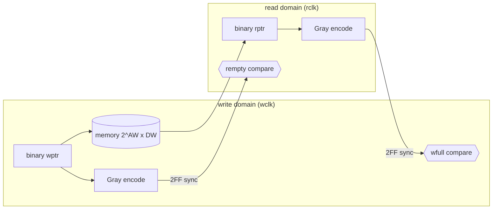

# 05 · FIFO, CDC & RDC

Synchronous and asynchronous FIFOs plus the standard clock-domain-crossing (CDC) and reset-domain-crossing (RDC) structures, each with a self-checking testbench, assertions where useful, and a small bug gallery that shows what goes wrong without them.

**Result: 18 / 18 regression checks pass** (`make test`), and all RTL is Verilator `-Wall` lint-clean.

## Quick start

```bash
make test                      # or: bash scripts/run_all.sh
```

Needs `iverilog` (11 or newer) and `verilator` (5.0 or newer). On Ubuntu/WSL: `sudo apt install iverilog verilator gtkwave`. The script exits non-zero if any check fails, and CI runs it on every push.

## Contents

```
05_FIFO_CDC_RDC/
├── rtl/
│   ├── sync_fifo.v         single-clock FIFO, flags, count
│   ├── async_fifo.v        two-clock FIFO, Gray pointers
│   ├── sync_2ff.v          2-flop synchronizer (+ sim-only bus-skew model)
│   ├── pulse_sync.v        toggle-based pulse synchronizer
│   ├── handshake_sync.v    4-phase req/ack multi-bit transfer
│   └── reset_sync.v        async-assert / sync-deassert reset
├── tb/                     self-checking testbenches
├── sva/                    SVA bind files (no RTL changes)
├── cdc_bugs/               bug gallery testbench
├── scripts/run_all.sh      one-command regression
└── Makefile                `make test`, `make clean`
```

## Spec

| Module | Parameters | Behaviour |
|---|---|---|
| `sync_fifo` | `DW`=8, `AW`=4, `ALMOST`=2 | Depth `2**AW`. First-word-fall-through read: `rdata` is valid whenever `!empty`. Outputs `full`, `empty`, `almost_full`, `almost_empty`, `count`. Writes while full and reads while empty are ignored. |
| `async_fifo` | `DW`=8, `AW`=4, `SKEW`=0 | Depth `2**AW`, independent `wclk`/`rclk` with their own active-low resets. Gray-coded pointers cross through two-flop synchronizers. Registered `wfull` / `rempty`. First-word-fall-through read. |
| `sync_2ff` | `W`=1, `SKEW`=0 | Two back-to-back flops. For single-bit signals or Gray-coded buses only. `SKEW` > 0 enables a simulation-only skew model (see Limitations). |
| `pulse_sync` | — | One-cycle pulse in the source clock becomes one-cycle pulse in the destination clock. Source pulses must be at least about 3 destination periods apart. |
| `handshake_sync` | `DW`=8 | Carries a word across domains with a 4-phase req/ack. Data is held stable in the source until the ack returns. `src_ready` shows when a new word can be accepted; `dst_valid` pulses for one destination cycle. |
| `reset_sync` | `STAGES`=2 | Reset asserts immediately (asynchronously) and releases synchronously with the clock. |

### How the async FIFO works



- Pointers are one bit wider than the address, so equal pointers mean empty and pointers differing only in the top bit mean full.
- Only the Gray-coded pointer crosses the boundary. It changes by one bit per increment, so a sample taken mid-change is either the old or the new value, never a value that did not exist.
- Empty compares the next read Gray pointer with the synchronized write Gray pointer. Full compares the next write Gray pointer with the synchronized read Gray pointer with its top two bits inverted.
- Both flags are registered, and a stale pointer only makes the FIFO look fuller or emptier than it really is, which is the safe direction. It cannot cause an overflow or an underflow.

## Test plan

| Check | What it does |
|---|---|
| `sync_fifo` | 60,000 cycles of random reads and writes. A reference model checks `full`, `empty`, `almost_full`, `count` and every data word each cycle. Traffic alternates between fill-heavy, drain-heavy and balanced phases. Passes only if both full and empty were actually reached. |
| `async_fifo` | 20,000 random words per run, scoreboarded in order. Run at 6 clock ratios, each with and without the bus-skew model (12 runs). Resets are released at different times and the clocks have an arbitrary phase offset. Also flags any read with nothing written. |
| `handshake_sync` | 300 random 16-bit words between unrelated clocks, resets released at different times. |
| `reset_sync` | Deassertion must only happen on a clock edge. Assertion must be immediate. 20 random release and re-assert times. |
| CDC bug gallery | Reproduces two classic bugs and checks that the fixes work (below). |
| SVA | Assertions on `sync_fifo` and `async_fifo` attached with `bind`, run alongside the same testbenches under Verilator `--assert`. |

Clock ratios used for the async FIFO (half-periods in ps, write/read probabilities in %):

| Write half | Read half | Write % | Read % | Regime |
|---|---|---|---|---|
| 5000 | 5000 | 70 | 70 | equal clocks |
| 5000 | 7300 | 70 | 40 | slower reader |
| 5000 | 13000 | 90 | 90 | much slower reader |
| 13000 | 5000 | 90 | 90 | much faster reader |
| 3100 | 11000 | 60 | 80 | about 3.5 : 1 |
| 7000 | 7100 | 50 | 50 | near-equal, drifting phase |

## Results

| Check | Result |
|---|---|
| Lint, 5 RTL modules (Verilator `-Wall`) | clean |
| `sync_fifo` | PASS (257,652 checks, 0 errors) |
| `async_fifo`, 6 ratios, plain | 6 / 6 PASS (20,000 words each, 0 errors) |
| `async_fifo`, 6 ratios, with skew model | 6 / 6 PASS (20,000 words each, 0 errors) |
| `handshake_sync` | PASS (300 / 300 words) |
| `reset_sync` | PASS |
| CDC bug gallery | PASS (bugs reproduced, fixes verified) |
| `sync_fifo` + SVA | PASS |
| `async_fifo` + SVA | PASS |
| **Total** | **18 / 18** |

### Assertions

`sva/fifo_sva.sv` (on `sync_fifo`): never full and empty at once, `count` in range, full and empty hold without an opposing operation, and a write with no read grows `count` by one. Cover properties check that full is reached, left, and that empty is reached.

`sva/async_fifo_sva.sv` (on `async_fifo`): each Gray pointer changes by at most one bit per clock in its own domain, plus cover properties for `wfull` and `rempty`.

## CDC bug gallery

`cdc_bugs/tb_cdc_bugs.v` reproduces two bugs and their fixes.

| Bug | Structure | Observed | Fix | Observed |
|---|---|---|---|---|
| Multi-bit bus through a plain 2FF | 8-bit counter, 100 MHz to about 43 MHz | 28 samples jumped by more than 8 counts, i.e. values that never existed | Gray-code the bus before the 2FF | 0 bad jumps in 434 samples |
| One-cycle pulse, fast to slow clock, through a plain 2FF | pulse every 12 source cycles | 35 of 83 pulses received | `pulse_sync` (toggle + edge detect) | 82 of 83 received (the last was still in flight when the run ended) |

For arbitrary multi-bit data that does not count by one, use `handshake_sync`.

### Crossing review

Every clock-domain or reset-domain boundary in this project and how it is handled:

| Signal | From | To | Structure | Why it is safe |
|---|---|---|---|---|
| `rgray` | `rclk` | `wclk` | Gray code + `sync_2ff` | one bit changes per step |
| `wgray` | `wclk` | `rclk` | Gray code + `sync_2ff` | one bit changes per step |
| `req` | source | destination | level + `sync_2ff` | held until the ack returns |
| `ack` | destination | source | level + `sync_2ff` | held until req drops |
| `data_hold` | source | destination | none (static bus) | stable from before req rises until after ack returns |
| `tog` | source | destination | toggle + `sync_2ff` + edge detect | a level change, not a pulse |
| `arst_n` | asynchronous | `clk` | `reset_sync` | async assert, synchronous deassert |

## Limitations

- **The skew model is a simulation approximation, not CDC sign-off.** RTL simulation has no metastability and no routing skew. `SKEW` delays bit *i* of a crossing bus by *i × SKEW* ps so that a multi-bit change can be sampled half old and half new. It demonstrates the bus-coherence failure; it does not prove a design is CDC-safe. Real sign-off needs a CDC tool and timing constraints.
- **A binary-pointer async FIFO could not be made to fail in simulation.** With registered flags and one-cycle glitches, the effect is hidden in zero-delay RTL sim. It is still wrong in silicon, and structural review (the crossing table above) is how this class of bug is caught.
- **`async_fifo` does not instantiate `reset_sync`.** The caller must reset both domains, and release each reset synchronously in its own clock domain.
- **Depth is a power of two only.** `AW` sets the depth; other depths are not supported.
- **Read data is combinational from the memory array** (first-word-fall-through). That is simple to verify but is not a drop-in for synchronous-read block RAM.
- **`handshake_sync` throughput is low by design.** Each word needs a full 4-phase round trip, a few cycles of both clocks.
- **`pulse_sync` needs spaced pulses** (at least about 3 destination periods apart) and drops the second of two closer pulses.
- **Async FIFO coverage varies by run.** In the fast-reader run the FIFO is never full, and in several slow-reader runs it reaches empty only a handful of times. Full and empty are both exercised in the equal-clock and near-equal-clock runs and in `sync_fifo`.
- **Fixed seeds.** Results are repeatable but cover one random stream per configuration. Pass `+SEED=<n>` to `vvp` for the async testbench to try others.
- **Assertions are run under Verilator only.** No other simulator has been used for the SVA files.
- **`SKEW` must stay 0 for synthesis.** It selects a simulation-only delay model.

## Notes

- Waveforms: add `$dumpfile("x.vcd"); $dumpvars(0, <tb>);` to a testbench, run `vvp`, then `gtkwave x.vcd`. VCD files are git-ignored.
- Rebuild from scratch: `make clean && make test`.
