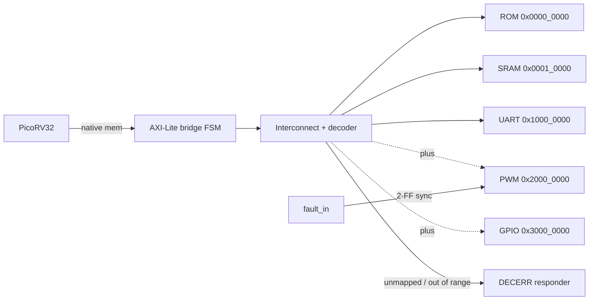

# RISC-V SoC Capstone: PicoRV32 + AXI4-Lite, with an EV motor-drive upgrade

A RISC-V SoC built from the open-source chip-design course flow (Verilator / Icarus, GTKWave, Yosys, LibreLane, sky130).
Two variants share all RTL:

| | `top` (base capstone) | `top_plus` (upgraded) |
|---|---|---|
| CPU | PicoRV32 (RV32I) | same |
| Bus | AXI4-Lite bridge, interconnect, decoder | same, plus **DECERR** default responder |
| Slaves | ROM, SRAM, UART | + **3-phase PWM IP core**, + **GPIO** |
| Pins | `clk reset uart_tx uart_rx` | + `fault_in gpio_in[7:0] gpio_out[7:0] pwm_h/l[2:0] adc_trig` |
| Firmware | greeting x10 + UART echo | EV soft-start demo, CSV telemetry, UART command shell |



## Memory map
Windows match the **real** memory sizes. Out-of-range accesses return DECERR (no wrap-around aliasing). Writes to ROM return SLVERR.

| Base | Peripheral | Registers |
|---|---|---|
| `0x0000_0000` | ROM (4 KB) | boot at reset vector 0; read-only |
| `0x0001_0000` | SRAM (1 KB sim / 256 B ASIC) | stack top = base + size |
| `0x1000_0000` | UART | `+0` TX (W), `+4` RX (R, clears flag), `+8` STATUS (b0 tx_busy, b1 rx_valid, b2 overrun, b3 frame_err), `+C` BAUDDIV (reset 434 = 115200 @ 50 MHz) |
| `0x2000_0000` | PWM (plus) | `+00` CTRL (b0 en, b1 sw_trip, b2 flt_en, b3 trip_clr), `+04` PSC, `+08` PER, `+0C` DT, `+10` ATRG, `+14` STATUS (b0 trp, b1 latched, b2 flt_in, b3 en), `+20+4i` DUTY[i] |
| `0x3000_0000` | GPIO (plus) | `+0` OUT, `+4` IN, `+8` STATUS (b0 sticky bus error, write clears) |

---

# Status

## Done and verified

| Item | Result |
|---|---|
| Address-aliasing bug in the decoder | Fixed (windows = real sizes, DECERR / SLVERR) |
| Firmware not rebuilt when SRAM size changed | Fixed (`fw/Makefile` tracks RAM size; 256 B build uses stack top `0x10100`) |
| `tb/tb_bus.v` bus test | 118 directed checks + 3000 random ops vs reference model: pass. Fails (1386 errors) if the old 64 KB decoder is put back |
| `tb/axil_checker.v` AXI4-Lite protocol checker | On CPU bus, ROM port, SRAM port: 0 violations on real firmware traffic; fires when an illegal EXOKAY is injected |
| Full SoC, base + plus | Pass (Verilator and Icarus). 0 shoot-through events, 2026 ADC triggers |
| ASIC-ROM test (case-ROM, 256 B SRAM) | Pass |
| `make lint` | Clean. Waivers (third-party PicoRV32, intentional unconnected pins) are in `tools/lint.vlt` |
| Coverage (`make cov`, full SoC-plus run) | Block 94.0 %, branch 74.5 %, toggle 57.7 % (PicoRV32 excluded) |
| `pwm_axi` shared loop variable (32 Yosys "conflicting drivers" warnings in run 1) | Fixed; confirmed in `final18` (0 warnings) |
| Yosys generic synth, 256 B SRAM | No latches. base ~14.1k cells / 3.9k flops, plus ~17.0k cells / 4.2k flops (exact numbers vary with Yosys version) |
| Firmware size | base 164 B, plus 1804 B of the 4 KB ROM |
| LibreLane configs + SDC | Ported to LibreLane 3.0.17 key names (all keys checked against the 3.0.17 variable list) |
| Staged run folder (`tools/openlane_prep.sh`) | Synthesizes cleanly in Yosys (17.0k / 14.1k cells) |

## Not done / open issues

| Item | Why / what it means |
|---|---|
| **Physical flow (plus, 18 ns): complete but NOT fully clean** | `final18`: 80/80 stages, setup +2.21 ns / hold +0.37 ns, Magic + KLayout DRC 0, LVS clean, antenna 0. **Open:** 1 router DRC marker (probably false, unverified), and max slew / max cap violations (3661 / 479) at the slow corners. See `docs/PPA.md` |
| Full-flow clock sweep at 16 ns or below, base variant run | Not run. The 16/14/12 ns rows in `docs/PPA.md` are re-timed from an older layout |
| `make wave-iv` | Not tested (the dump of the full run can be large) |
| riscv-arch-test, OpenRAM SRAM macro | Not started (optional extras) |
| GitHub repo | Not created yet: that is your step 4 and step 9 |

Only report physical-flow results that appear in `docs/PPA.md`, and say plainly which checks still fail.

---

# Reproduce

Tested on Ubuntu under WSL2. Keep the project under your Linux home (`~/`), not `/mnt/c`.

**1. Simulation (no PDK needed)**
```bash
sudo apt update && sudo apt install -y verilator yosys gcc-riscv64-unknown-elf python3-matplotlib make git iverilog gtkwave zlib1g-dev unzip
make test-iverilog          # Icarus only; a few minutes -> === ALL IVERILOG TESTS PASSED ===
make test                   # Verilator       -> === ALL TESTS PASSED ===
make lint                   # -> === LINT CLEAN ===
make test-asic-rom          # -> === ASIC-ROM TEST PASSED ===
SRAM_WORDS=64 make synth    # Yosys sanity check, expect "latches: none"
make cov                    # writes docs/coverage.md
```

**2. Physical flow (LibreLane 3.0.17 + sky130A, about 2.5 h)**
Install LibreLane following https://librelane.readthedocs.io (Nix route), then:
```bash
bash tools/openlane_prep.sh plus ~/librelane_runs      # firmware at 256 B SRAM, case-ROM, copies RTL + config
cd ~/librelane && nix-shell                            # LibreLane shell
cd ~/librelane_runs/riscv_soc_plus
librelane --run-tag final18 config.json
```
Results land in `runs/final18/final/metrics.json`. The committed evidence of my run is in `docs/physical/` (metrics, LVS report, Magic DRC report, router DRC marker, the exact config). The GDS is attached to the GitHub Release, not committed.

## LibreLane config: OpenLane-1 -> LibreLane renames used here
`PL_TARGET_DENSITY` -> `PL_TARGET_DENSITY_PCT` - `FP_PIN_ORDER_CFG` -> `IO_PIN_ORDER_CFG` - `BASE_SDC_FILE` -> `PNR_SDC_FILE` + `SIGNOFF_SDC_FILE` - `CTS_CLK_BUFFER_LIST` -> `CTS_CLK_BUFFERS` - `GLB_RESIZER_*` -> `GRT_RESIZER_*` - `ROUTING_CORES` -> `DRT_THREADS` - `IO_PCT` -> `IO_DELAY_CONSTRAINT` - `GRT_REPAIR_ANTENNAS` -> `RUN_ANTENNA_REPAIR` - `FP_PDN_*PITCH/OFFSET` -> `PDN_*PITCH/OFFSET` - `PL_RESIZER_MAX_*` -> `DESIGN_REPAIR_MAX_*`.
Dropped (no equivalent): `CTS_TARGET_SKEW`, `GLB_RT_MAXLAYER`, `FP_PDN_AUTO_ADJUST`, `FP_PDN_CORE_RING`, `RUN_DRC`, `RUN_SPICE_EXTRACTION`, `RUN_ANTENNA_CHECK`, `SYNTH_BUFFERING`, `DRT_MIN_ACCESS_POINTS`.
The SDC treats `reset uart_rx fault_in gpio_in[*]` as asynchronous (`set_false_path -from`): they enter through 2-FF synchronisers.

## Make targets
| Target | What it does |
|---|---|
| `make test` | PWM unit test, bus test, base SoC, SoC-plus (Verilator) |
| `make test-iverilog` | Same suite on Icarus Verilog |
| `make test-bus` / `test-bus-iv` | Bus-level directed + random test with protocol checkers |
| `make test-asic-rom` | Boot SoC-plus from the synthesizable case-ROM at 256 B SRAM |
| `make lint` | Verilator `-Wall`; fails on any non-waived warning |
| `make cov` | Coverage run, writes `docs/coverage.md` |
| `make synth` | Yosys sanity check (`SRAM_WORDS=64`) |
| `make wave` / `wave-iv` | Trace + GTKWave (`wave-iv` untested) |
| `make dash` | Plot UART telemetry to `docs/telemetry.png` |
| `python3 tools/render_layout.py <gds> <png> [cx cy half_um]` | Zoomed layout render, lower layers only (the flow's own full-die render is a solid block because the top metal hides everything) |


## Layout
`rtl/` hardware - `fw/` C + startup + linker - `tb/` testbenches + protocol checker - `tools/` scripts - `openlane/` LibreLane configs - `docs/` plots, logs, coverage, PPA table, `docs/physical/` flow evidence.

PicoRV32 is (c) Claire Xenia Wolf, ISC licence (`docs/PICORV32_LICENSE.txt`). Everything else MIT.
